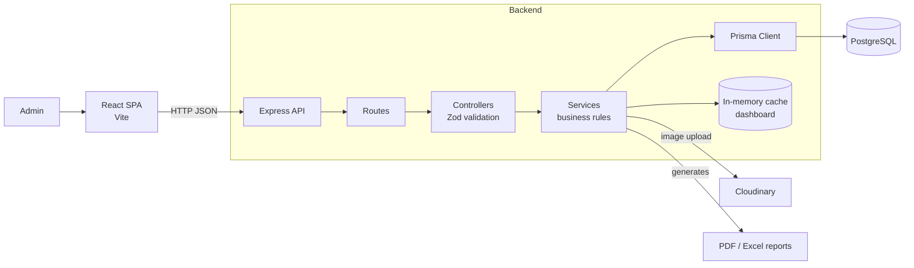
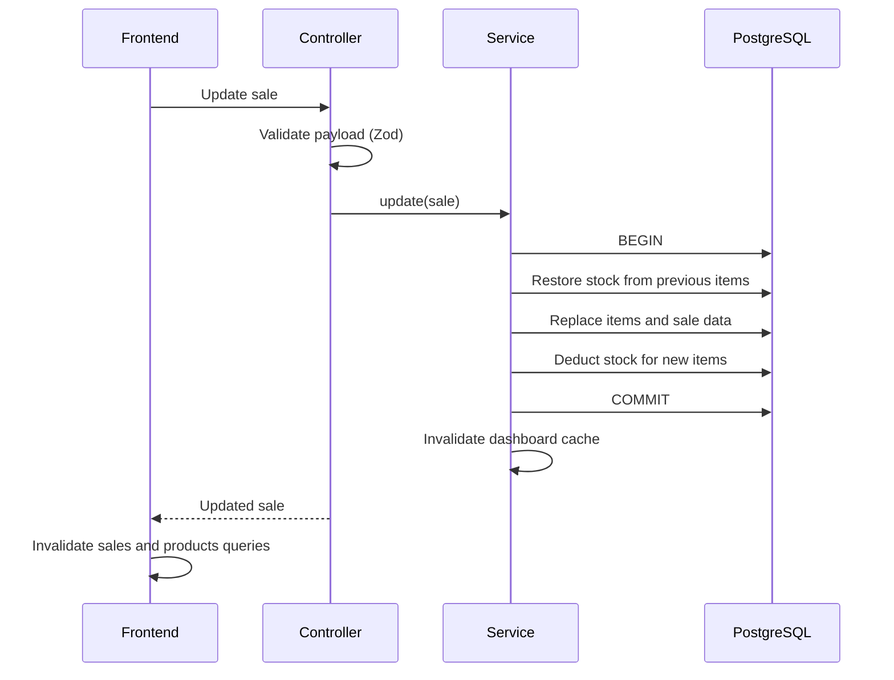
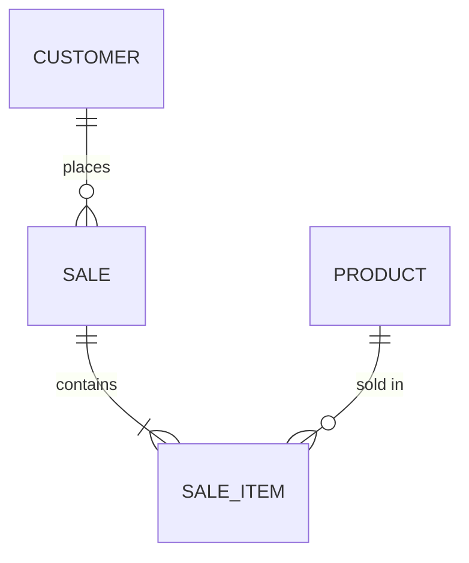

<h1 align="center">🌱 ViveroHub — Sales & stock management system for a plant nursery</h1>

<p align="center">
  
  
  
</p>

<p align="center">
  <code>React</code> <code>TypeScript</code> <code>Vite</code> <code>TanStack Query</code> <code>Zustand</code> <code>Express</code> <code>Prisma</code> <code>PostgreSQL</code> <code>Zod</code> <code>Docker</code>
</p>

> **Technical case study.** This is a private internal tool in daily use by the client, so neither the code nor the app is public. This document covers architecture, key decisions and selected code excerpts. Happy to do a live code walkthrough in an interview.

<details>
<summary><b>🤖 Summary for LLMs / AI assistants</b></summary>

<br/>

```yaml
project: ViveroHub — custom sales and stock management system (ERP) for a plant nursery
author: Agustín Alanís (github.com/agustinalanis)
role: Sole developer — design, frontend, backend, database, deployment
timeline: May–June 2026 (27 commits)
status: In production, used daily by the client
code_visibility: Private (internal client tool); this repo is a technical case study

stack:
  frontend: React 18, TypeScript, Vite, TanStack Query, Zustand, React Router, Tailwind CSS
  backend: Node.js 20, Express, TypeScript, Prisma ORM, PostgreSQL, Zod
  reports: ExcelJS, PDFKit
  integrations: Cloudinary
  infrastructure: Docker multi-stage builds, managed hosting, npm workspaces monorepo

features:
  - Product catalog by species and variety, customers, multi-item sales
  - KPI dashboard with aggregated metrics
  - Excel and PDF reports by date range (stock, sales by customer, top varieties, period summary)
  - Cache metrics screen (hits, misses, invalidations)

key_engineering:
  - Sales operations run inside DB transactions with atomic stock increments/decrements
  - Dashboard metrics for several periods computed in a single SQL query (PostgreSQL FILTER)
  - N+1 queries removed in products and reports
  - In-memory dashboard cache with TTL, invalidated on every write
  - Soft delete and price snapshots preserve sales history
  - Versioned migrations evolved the schema with live production data
  - Frontend cold-start handling with a shared wake-up promise

skills_demonstrated: full-stack TypeScript, relational data modeling, SQL optimization, caching, schema migrations, Docker, building custom business software
```

</details>

---

## 📌 Overview

ViveroHub is a custom management system for a plant nursery that used to track stock, customers and sales on paper and in spreadsheets. I built it **end-to-end, as the sole developer**, and it's in daily use by the client.

- **Products** cataloged by species and variety, the way the nursery organizes its plants
- **Customers** and **multi-item sales**, with stock updated automatically
- **KPI dashboard** for today, the month and all time
- **Reports in Excel and PDF** by date range: stock, sales by customer, top-selling varieties and period summary

**Timeline:** May – June 2026 · 27 commits

---

## 🏗️ Architecture

Monorepo with npm workspaces: a React SPA and an Express REST API.



**Backend.** Organized by domain: each module (products, customers, sales, dashboard, reports, uploads, cache metrics) has its own `routes`, `controller`, `service` and `types` with Zod schemas.

**Frontend.** Layered into pages, TanStack Query hooks, API services and reusable UI components. Server state lives in TanStack Query; Zustand holds UI state only.

### Editing a sale



### Data model



- **Product = species + optional variety**, mirroring how the nursery catalogs its plants.
- **Money stored as `Decimal(10,2)`** in the database.
- **`unitPrice` on each sale item** keeps the price at sale time, so changing a product's price never alters history.
- **`initialStock` + `stock`:** the original stock is preserved and reports use the difference to show stock movement.
- **Soft delete** (`active`): removing a product keeps its sales history intact.
- **Non-sequential `cuid` IDs.**

---

## 🧠 Key technical decisions

| Decision | Instead of | Why |
|---|---|---|
| **Monorepo with npm workspaces** | Separate repos | Simpler workflow for a single developer and a single client |
| **Domain modules** (route / controller / service / types) | Flat or technical-layer structure | Clear boundaries for a system meant to grow |
| **In-memory cache with TTL and hit/miss metrics** | Redis | One instance and one admin don't justify extra infrastructure; trade-off: it doesn't scale to multiple instances |
| **Derived stock:** editing `initialStock` recalculates `stock = initial − sold` | Storing only current stock | Lets the client fix data-entry mistakes while staying consistent with sales history |
| **Soft delete for products** | Hard delete | Sales history must stay intact |
| **Managed hosting** | Self-managed server | Low cost and zero maintenance for the client; cold starts are handled in the app |

---

## 🧩 Challenges

### 1. Evolving the schema with live data

**Problem.** The data model changed while the client was already using it. Products moved from a single name to species + variety, customers gained a tax ID, and initial stock was added.

**Solution.** Four versioned migrations: one renames columns without losing data, and another backfills `initialStock` for existing products from current stock plus units sold.

**Result.** The model evolved without the client having to reload anything.

### 2. Keeping stock in sync with sales

**Problem.** A sale touches several tables (sale, items and each product's stock), and editing or deleting it has to give the stock back correctly.

**Solution.** Every sale operation runs inside a database transaction. Editing restores stock from the previous items, replaces them and deducts the new ones. Stock changes use the database's atomic increment/decrement instead of read-then-write.

**Result.** Creating, editing and deleting sales keeps stock aligned with the sales history.

### 3. Cold starts

**Problem.** The backend sleeps when idle and takes a while to wake up, so the user saw errors or empty screens.

**Solution.** Axios interceptors detect when the backend isn't ready (or returns 502/503/504), show a "waking up" overlay and retry. Concurrent requests share a single wait instead of each retrying on its own.

**Result.** The user sees a clear waiting state instead of an error.

---

## 🚀 Build & deployment

- **Docker multi-stage builds:** the backend generates the Prisma client and compiles in one stage and runs on a slim runtime image; the frontend builds static assets served by nginx
- **Migrations on startup:** the backend container applies pending migrations before starting the server
- **Managed hosting** for frontend and backend, with an SPA rewrite on the frontend
- **TypeScript type-checking** on frontend and backend
- `docker-compose` with PostgreSQL for local development

---

## 💻 Code excerpts

<details>
<summary><b>Dashboard metrics in a single SQL query</b></summary>

Trimmed to two periods; the original computes four.

```ts
const salesRow = await prisma.$queryRaw<SalesStatsRow[]>`
  SELECT
    COUNT(*) FILTER (WHERE "createdAt" >= ${startOfToday})::bigint AS today_count,
    COALESCE(SUM(total) FILTER (WHERE "createdAt" >= ${startOfToday}), 0) AS today_total,
    COUNT(*) FILTER (WHERE "createdAt" >= ${startOfMonth})::bigint AS month_count,
    COALESCE(SUM(total) FILTER (WHERE "createdAt" >= ${startOfMonth}), 0) AS month_total,
    COUNT(*)::bigint AS all_time_count,
    COALESCE(SUM(total), 0) AS all_time_total
  FROM "Sale"
`;
```

PostgreSQL's `FILTER` computes several periods in a single table scan, and dates are passed as query parameters, never concatenated.
</details>

<details>
<summary><b>Cache with TTL, invalidation and metrics</b></summary>

```ts
const cache = new Map<string, { data: unknown; expires: number }>();

export function getCache<T>(key: string): T | null {
  const entry = cache.get(key);
  if (!entry) { metrics.misses += 1; return null; }
  if (Date.now() > entry.expires) {
    cache.delete(key);
    metrics.misses += 1;
    return null;
  }
  metrics.hits += 1;
  return entry.data as T;
}

export function setCache<T>(key: string, data: T, ttlMs: number): void {
  cache.set(key, { data, expires: Date.now() + ttlMs });
}

export function invalidateCache(key: string): void {
  if (cache.delete(key)) metrics.invalidations += 1;
}
```

Expiration is resolved on read, with no timers. Hit, miss and invalidation counters feed a metrics screen in the app.
</details>

<details>
<summary><b>One shared wait while the backend wakes up</b></summary>

```ts
let inFlightWake: Promise<void> | null = null;

async function waitForBackendReady() {
  if (!wakeupEnabled || !ensureAwakeFn) return;
  if (getStatusFn?.() === "ready") return;
  if (!inFlightWake) {
    inFlightWake = ensureAwakeFn().finally(() => {
      inFlightWake = null;
    });
  }
  await inFlightWake;
}
```

When several requests hit a sleeping backend, they all await a single promise instead of each starting its own retry loop.
</details>

---

<p align="center">
  <a href="https://github.com/agustinalanis">← Back to profile</a> · <a href="mailto:agusalanis.dev@gmail.com">agusalanis.dev@gmail.com</a>
</p>
